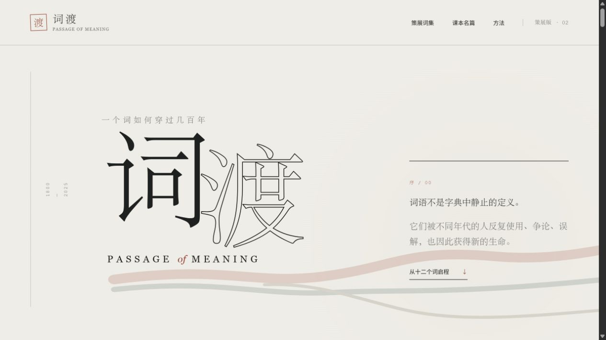
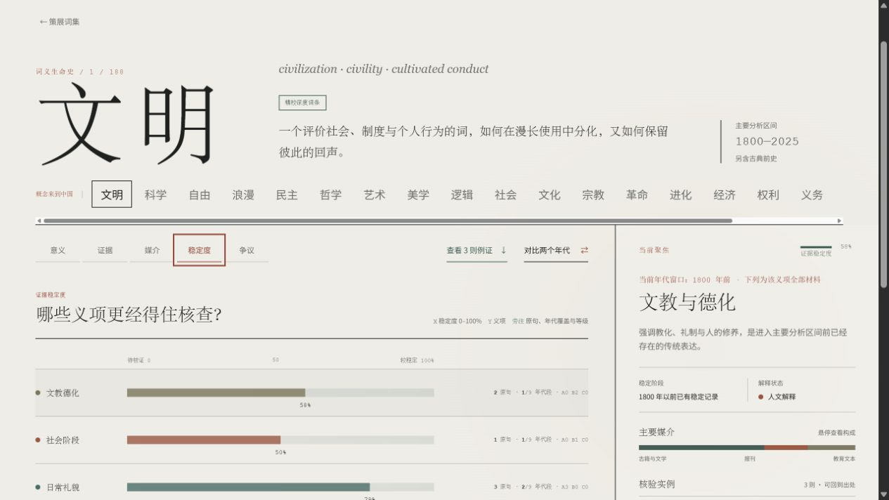
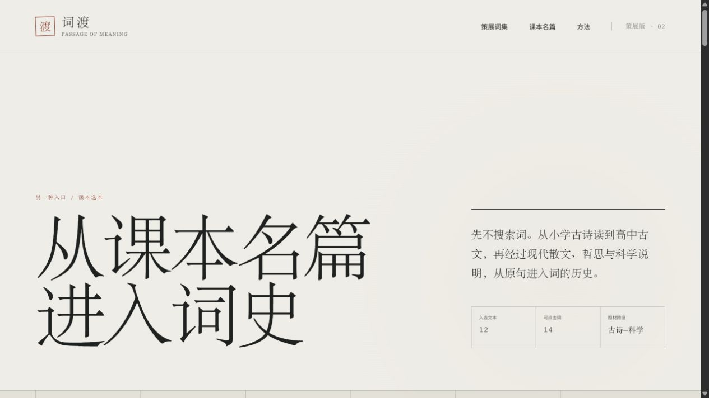

<div align="center">

# 词渡 · Passage of Meaning

<a id="english"></a>
**Compare dated examples of a word, then return to the source to read it in context.**

An evidence-led, interactive atlas of Chinese word histories.

**English** · [简体中文](README.md)

[Explore](#从一个熟悉的词出发) · [Screenshots](#看得见依据也看得见空白) · [Run locally](#本地运行) · [Evidence and method](#证据如何进入界面) · [Human review](#ai-与人工复核)

</div>



When did “平台” begin to mean an internet platform? When a word gains a meaning, does its earlier use remain? Passage of Meaning brings these questions back to dated examples and their sources.

Start with familiar words such as “文明,” “平台,” and “粉丝.” Inspect the original sentence, source, context, evidence grade, and verification state. The project is an explorable humanities research interface with routes back to sources, not an automatically generated set of definitive etymologies.

<a id="从一个熟悉的词出发"></a>
## Start with a familiar word

1. Choose a research route and search or filter the catalog, from translated concepts and social identities to market life and platform culture.
2. Open the word workbench. Its views are 意义 (meaning), 证据 (evidence), 媒介 (media), 稳定度 (stability), and 争议 (disputes).
3. Select a timeline node to read the dated sentence and its context, then open the source and check what it supports.
4. Try the textbook-literature entry point. Highlighted words lead into word histories, connecting familiar texts with the workbench.

| Current scope | How to read it |
| --- | --- |
| **188 curated catalog entries / 10 research routes** | The exploration catalog and research scope, not 188 settled etymological conclusions |
| **4 closely curated entries** | 文明, 同志, 平台, 粉丝; the remaining entries retain research / pending-verification labels |
| **12 textbook works** | Highlighted words connect reading to the word workbench |
| **A / B / C evidence grades** | Read alongside source, context, and review labels; a grade does not replace checking the original |

These counts describe the current repository data. The homepage's “twelve launch words” entry is a separate guided selection, not the full catalog count.

<a id="看得见依据也看得见空白"></a>
## Evidence and gaps are both visible



- A timeline node is a source item. The main timeline selects items labeled “语料事实” (corpus facts), ordered by source year. Senses without qualifying evidence remain empty.
- A source year is not a first-attestation date. An example from 1902 establishes inspectable usage at that point, not the absence of earlier usage.
- Connecting lines are editorial meaning relationships, not frequency trends, diffusion speeds, or causal measurements.
- Facts and interpretations are separated. The data distinguish corpus facts, computed results, and humanities interpretations, with states such as reviewed or disputed.

<details>
<summary>Another entry point: from textbook literature to word histories</summary>



Highlighted words open their research views. This is a reading route, not a claim to include every textbook word or a complete history of textual editions.

</details>

<a id="本地运行"></a>
## Run locally

This is a **React 19 + TypeScript + Vite** frontend with bundled data. It requires no database or model API key. Use a Node.js environment compatible with the current Vite 8 and pnpm; the repository contains `pnpm-lock.yaml`.

```bash
git clone https://github.com/yuzhang-zhong/passage-of-meaning.git
cd passage-of-meaning
pnpm install --frozen-lockfile
pnpm dev
```

Open the local address printed by the terminal.

```bash
pnpm build       # TypeScript 检查 + Vite 生产构建
pnpm preview     # 预览已构建的 dist
```

[`package.json`](package.json) defines the commands. There is no separate test script; the production build includes TypeScript checks. Reader-submitted examples stay in browser `localStorage`: **they do not enter a shared research corpus** and do not automatically survive changing browsers or clearing site data.

<a id="证据如何进入界面"></a>
## How evidence reaches the interface

```text
Source texts / dictionaries / corpus candidates
        ↓ Retrieval, selection, and checks of year and context
Structured Evidence → Sense → WordStory
        ↓ Combine the curated catalog, manual material, and generated data
Word workbench / source-material timeline / evidence reader
```

| File / directory | Responsibility |
| --- | --- |
| [`src/catalog.ts`](src/catalog.ts) | Curated themes, the 188-word catalog, and categories |
| [`src/data.ts`](src/data.ts) | `Evidence` / `Sense` / `WordStory` types and closely curated stories |
| [`src/storyCatalog.ts`](src/storyCatalog.ts) | Combines the catalog, sense blueprints, and multiple evidence sources |
| [`src/literary.ts`](src/literary.ts) | Textbook works and their word entry points |
| [`src/manualSenseEvidence.ts`](src/manualSenseEvidence.ts), [`src/modernEvidence.ts`](src/modernEvidence.ts) | Manually organized evidence and modern contexts |
| Generated files such as [`src/timelineEvidence.generated.json`](src/timelineEvidence.generated.json) | Evidence organized through the research process, not unscreened crawl results |
| [`research/`](research/) | Candidate collection, evidence selection, dictionary processing, and audit scripts |
| [`design-system/词渡-passage-of-meaning/MASTER.md`](design-system/词渡-passage-of-meaning/MASTER.md) | Visual specification |

Each evidence item carries its original sentence, context, source, year, medium, grade, interpretation status, source link, and review status. Preserve these fields and the source's uncertainty when extending the content. Do not invent dates or sentences to fill a timeline.

<a id="ai-与人工复核"></a>
## AI assistance and human review

AI assists interface implementation, catalog expansion, and candidate-evidence retrieval. Sense classification, exclusion of sensitive contexts, year checks, and source selection still require item-by-item human review. Research scripts and candidate-selection records remain in the repository.

“已核验” is an editorial state in this project, not independent academic certification. Before citation, teaching, or formal research, check the original document, edition, completeness of the quotation, and date. Research-stage entries should not be treated as equally mature as the closely curated stories.
