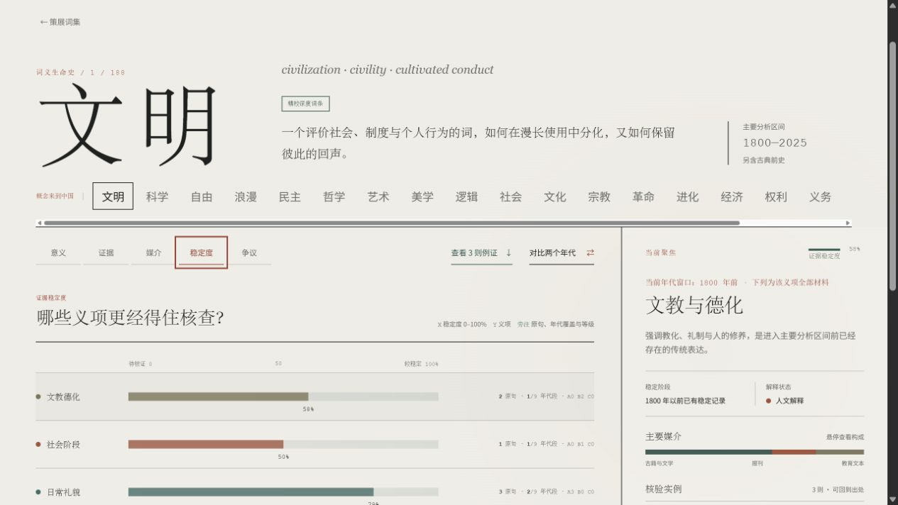

<div align="center">

# 词渡 · Passage of Meaning

**简体中文** · [English (full README)](README.en.md)

**比对一个词在不同年代的用例，回到出处读它的意思。**

An evidence-led, interactive atlas of Chinese word histories.

[如何探索](#从一个熟悉的词出发) · [界面预览](#看得见依据也看得见空白) · [本地运行](#本地运行) · [证据与方法](#证据如何进入界面) · [人工复核](#ai-与人工复核) · [English](#english)

</div>


“平台”什么时候开始指互联网服务？一个词有了新义，旧的用法还在不在？词渡把这些问题放回带年份的用例和出处中阅读。

从“文明”“平台”“粉丝”这样的日常词进入，沿着带年份的材料查看原句、出处、语境、证据等级与核验状态。它是一个可探索、可回到来源的人文研究界面，不是一套自动生成的确定词源答案。

## 从一个熟悉的词出发

1. **挑一条研究路线。** 从概念翻译、社会身份、市场生活到平台文化，在词表中搜索或筛选。
2. **打开词义工作台。** 比较“意义、证据、媒介、稳定度、争议”五种观察视角。
3. **点开一个时间节点。** 阅读带日期的原句和上下文，再打开来源核对它究竟能证明什么。
4. **换个入口。** 从课本名篇中的高亮词进入词史，观察熟悉文本里的词与今天的词是否还是同一个意思。

| 当前内容范围 | 应该怎样理解 |
| --- | --- |
| **188 个策展词条 / 10 条研究路线** | 是探索目录与研究范围，不等于 188 个全部定论的词源结论 |
| **4 个精校词条** | 文明、同志、平台、粉丝；其余词条在界面中保留研究 / 待核证标识 |
| **12 篇课本名篇** | 通过高亮词连接文本阅读与词义工作台 |
| **A / B / C 证据等级** | 结合来源、语境与复核标识阅读，不能仅凭等级跳过原文 |

这些数量对应当前仓库数据。首页另保留“十二个首发词”的导览入口，它不是全部词表的数量。

## 看得见依据，也看得见空白



- **时间轴上的一点是一则材料。** 主时间轴筛选“语料事实”，按材料年份排列；没有合格材料的义项会留空。
- **材料年份不等于首次出现年份。** 找到 1902 年的一句用例，只能说明这个时间点存在可检查的使用，不能证明此前从未出现。
- **连线不是统计趋势。** 它表达编辑上的意义关联，不是词频曲线、扩散速度或严格的因果关系。
- **解释与事实分开。** 数据同时标记“语料事实”“计算结果”“人文解释”，并保留“已核验 / 有争议”等状态。

<details>
<summary>另一个阅读入口：从课本名篇回到词史</summary>


页面中的高亮词可以进入相应研究视图。课文入口是一条阅读路径，不代表它收录了教材中的全部词语或完整版本史。
</details>

## 本地运行

这是 **React 19 + TypeScript + Vite** 前端，数据随仓库提供，不需要数据库或模型 API key。请准备能运行当前 Vite 8 的 Node.js 环境与 pnpm；项目包含 `pnpm-lock.yaml`。

```bash
git clone https://github.com/yuzhang-zhong/passage-of-meaning.git
cd passage-of-meaning
pnpm install --frozen-lockfile
pnpm dev
```

打开终端打印的本地地址。

```bash
pnpm build       # TypeScript 检查 + Vite 生产构建
pnpm preview     # 预览已构建的 dist
```

命令以 [`package.json`](package.json) 为准。项目没有单独的测试脚本；生产构建包含 TypeScript 检查。当前“用户例句”保存在浏览器 `localStorage` 中，**不会提交到共享语料库**，换浏览器或清除站点数据后也不会自动保留。

## 证据如何进入界面

```text
来源文本 / 词典 / 语料候选
        ↓ 检索、取舍、年份和语境核对
结构化 Evidence → Sense → WordStory
        ↓ 合并策展词表、手工材料与生成数据
词义工作台 / 真实材料时间轴 / 证据阅读器
```

| 文件 / 目录 | 负责什么 |
| --- | --- |
| [`src/catalog.ts`](src/catalog.ts) | 策展主题、188 词目录与分类 |
| [`src/data.ts`](src/data.ts) | `Evidence` / `Sense` / `WordStory` 类型与精校故事 |
| [`src/storyCatalog.ts`](src/storyCatalog.ts) | 组合词表、义项蓝图与多来源证据 |
| [`src/literary.ts`](src/literary.ts) | 课本名篇及其词语入口 |
| [`src/manualSenseEvidence.ts`](src/manualSenseEvidence.ts)、[`src/modernEvidence.ts`](src/modernEvidence.ts) | 手工整理与现代语境材料 |
| [`src/timelineEvidence.generated.json`](src/timelineEvidence.generated.json) 等生成文件 | 研究流程整理后的证据数据，不是未经筛选的抓取结果 |
| [`research/`](research/) | 候选收集、证据选择、词典处理与审计脚本 |
| [`design-system/词渡-passage-of-meaning/MASTER.md`](design-system/词渡-passage-of-meaning/MASTER.md) | 视觉规范 |

每条证据携带原句、语境、来源、年份、媒介、等级、解释状态、来源链接与复核状态。扩展内容时应保留这些字段，以及来源本身的不确定性；不要为了填满时间轴而补造日期或原句。

## AI 与人工复核

项目使用 AI 辅助界面实现、词表扩展与语料候选检索。词义归类、敏感语境排除、年份核对和材料取舍仍需要人工逐条检查，研究脚本与候选选择记录保留在仓库中。

“已核验”是项目中的编辑状态，不是独立学术认证。引用、教学或正式研究前仍应回到原始文献，核对版本、引文完整性和年代；研究词条也不应与精校词条视作同等成熟。

## English

Passage of Meaning is an interactive digital-humanities atlas of **diachronic lexical semantics, etymology, and Chinese word meaning shifts** across centuries. Its current catalog contains 188 words across 10 research routes, with four deeply curated word histories (*wenming* 文明, *tongzhi* 同志, *pingtai* 平台, *fensi* 粉丝) and a broader set of research-stage entries, plus twelve classic textbook works offering a literary reading path into historical corpus citations.

The interface separates senses, evidence, media, stability, and disputes. Timeline nodes represent dated source material, **not first attestations**; connecting lines are editorial relationships, not corpus-frequency measurements. AI assists discovery and implementation, while source selection and interpretation require human review.

Clone the repository, run `pnpm install --frozen-lockfile`, then `pnpm dev`. The app uses bundled data with no database or model API key. Reader-submitted examples remain in browser-local storage rather than a shared research corpus.
